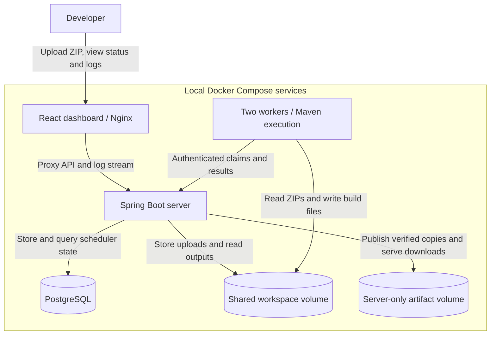
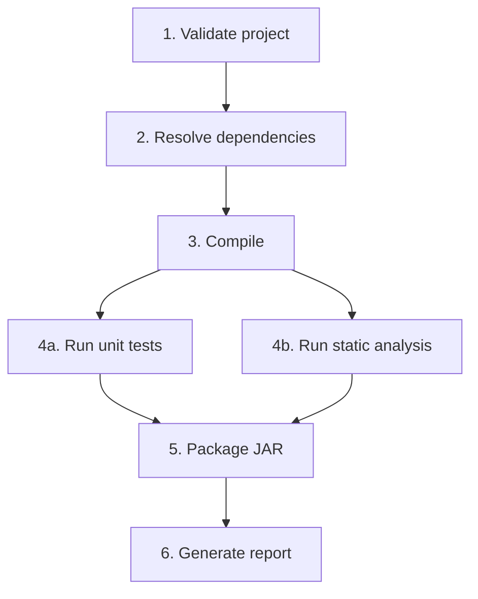
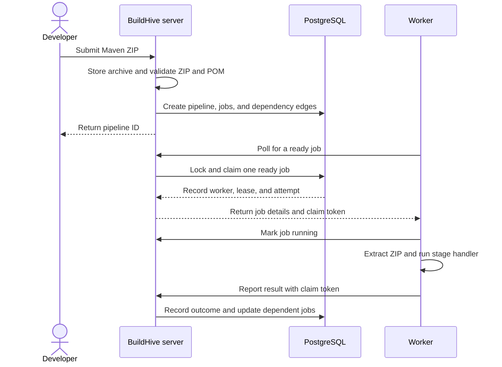
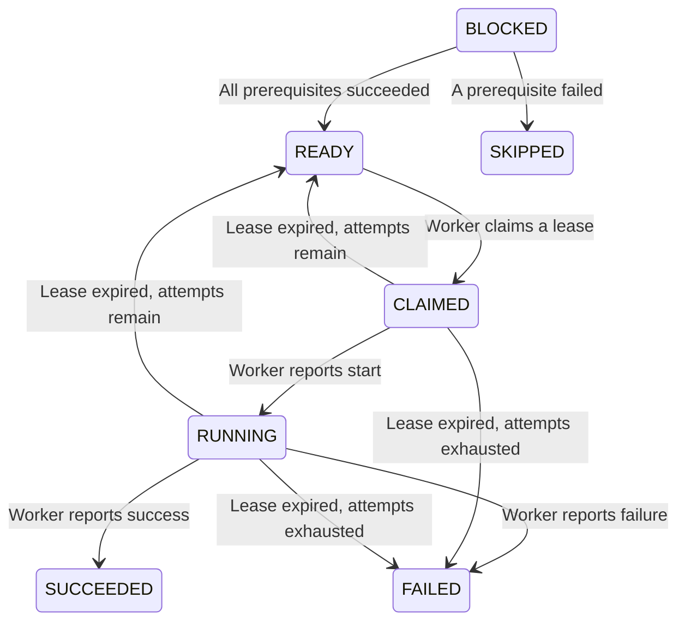

# BuildHive

BuildHive runs build and verification jobs for trusted Java Maven projects. A developer uploads a ZIP, follows the build in a dashboard, and downloads the JAR and available reports. The scheduler decides which jobs can run, assigns them to workers, and records what happened on each attempt.

## The problem

A build has dependencies. Tests need a project that compiles, and packaging should wait for verification. Some checks can run in parallel. When multiple workers are available, the scheduler must prevent them from claiming the same job and recover work left behind by a crashed worker. Users need enough history to distinguish a build failure from an execution problem.

BuildHive uses a fixed dependency graph, a PostgreSQL job queue, and independently polling workers to coordinate those decisions.

## Architecture

Docker Compose starts a React dashboard served by Nginx, a Spring Boot server, PostgreSQL, and two Spring Boot workers. Arrows show which component initiates an interaction.

[Rendered architecture diagram](docs/diagrams/architecture.svg) is available for readers without Mermaid support.

Read from the developer through the dashboard to the server, then follow the worker and storage connections. PostgreSQL holds scheduler state and artifact metadata. The shared workspace volume holds archives, logs, and temporary build files. The server copies validated outputs into a separate artifact volume mounted only by the server; workers have no mount for it. Workers authenticate to the API and still need shared workspace paths in the current design.

## The Maven pipeline

Each submission creates seven jobs. An arrow means the upstream job must succeed before the downstream job becomes eligible. Unit tests and static analysis can run on different workers. Packaging waits for both.

The graph controls scheduling order. Each attempt extracts the original ZIP into its own workspace, so downstream jobs do not receive compiled files from earlier jobs. Maven can repeat earlier lifecycle phases in the fresh workspace. The report DAG stage completes on successful builds. The server prepares a terminal pipeline report from persisted outcomes, including failure and cancellation.

## How a worker gets a job

The first job starts ready and the rest start blocked. PostgreSQL's `FOR UPDATE SKIP LOCKED` lets competing claims skip rows already locked by another transaction. A successful result can make dependent jobs ready. A final failure skips blocked downstream jobs. When a lease expires, the server can return the job to the queue or fail it if the attempt limit has been reached.

The graph shows the normal execution and recovery paths. Cancellation is handled separately by marking the pipeline and its nonterminal jobs cancelled in the database.

## Where to read the code

| Area | Entry point | What it explains |
| --- | --- | --- |
| Submission | [SubmissionService](buildhive-server/src/main/java/com/buildhive/server/service/SubmissionService.java) | Archive storage, validation, and pipeline creation |
| Pipeline shape | [PipelineBlueprint](buildhive-common/src/main/java/com/buildhive/common/dag/PipelineBlueprint.java) | The seven jobs and their dependencies |
| Scheduling | [JobClaimingService](buildhive-server/src/main/java/com/buildhive/server/service/JobClaimingService.java), [JobStateTransitionService](buildhive-server/src/main/java/com/buildhive/server/service/JobStateTransitionService.java) | Atomic claims, attempt outcomes, and readiness |
| Recovery | [LeaseReaperService](buildhive-server/src/main/java/com/buildhive/server/service/LeaseReaperService.java) | Expired claims and retry limits |
| Execution | [WorkerDaemon](buildhive-worker/src/main/java/com/buildhive/worker/daemon/WorkerDaemon.java), [stage handlers](buildhive-worker/src/main/java/com/buildhive/worker/handler) | Polling, workspaces, Maven execution, and output registration |
| Dashboard | [Frontend pages](buildhive-frontend/src/pages) | Uploads, pipeline history, job details, and worker status |
| Deployment | [Docker Compose](docker-compose.yml), [database schema](buildhive-server/src/main/resources/db/migration/V1__init_schema.sql) | Service configuration, storage mounts, and persistent records |

## Try the project locally

From the repository root, run `python scripts/configure_workers.py` once to generate private worker credentials in `.env`, then run `docker compose up --build` and open the dashboard at `http://localhost:3000`. Run `python sample-projects/generate_samples.py` to create the [sample ZIPs](sample-projects/README.md) for successful builds, stage failures, retries, cancellation, and rejected uploads. Upload `calculator-pass.zip` on the submission page and open the pipeline detail to inspect the graph, Checkstyle results, and JAR.

The Java source targets Java 21 and the runtime containers and CI use Java 25. The frontend container build and CI use Node.js 24. With Docker available, run `mvn clean verify` from the root for the Java tests, PostgreSQL tests, packages, and Checkstyle. From `buildhive-frontend`, run `npm ci`, `npm run lint -- --deny-warnings`, and `npm run build` for the frontend gate.

## Changes still needed

1. **Preserve the verified scheduler guarantees.** Parallel completion, scheduled lease recovery, cancellation, and duplicate completion handling now have PostgreSQL regressions. Pipeline mutations acquire a shared database lock before reading dependency state. Idle worker expiry is checked independently of job expiry.
2. **Preserve renewable ownership and cancellation.** Workers now renew bounded attempt leases and stop Maven process trees on rejected ownership, local expiry, interruption, or timeout. Real slow-build and cancellation scenarios verify this behavior.
3. **Preserve consistent retry semantics.** Expired leases and reported infrastructure errors share bounded backoff and attempt limits. Completion delivery retries preserve the original result, and duplicate acknowledgements cannot rewrite a newer attempt.
4. **Define how stages share outputs.** Required JAR publication now creates a verified durable copy, and repeated registration returns the same artifact for an attempt. Decide which intermediate build outputs should be passed to later jobs and which may be regenerated.
5. **Verify hosted CI.** Local checks cover Java and frontend quality, PostgreSQL integration, and Docker Compose scenarios. A passing GitHub Actions run for the current changes still needs to be recorded.
6. **Keep the trust boundary explicit.** Worker mutations now require a configured credential bound to the worker name; log writes require an active claim. Artifact publication verifies paths, size, and SHA-256 before copying bytes to server-only storage. The current deployment remains for trusted local Maven ZIPs: user accounts, TLS for remote deployment, and isolation of project-controlled Maven code remain separate work.

See [the CI workflow](.github/workflows/ci.yml) for the automated quality checks and Compose scenarios.

## Worker credentials and artifact storage

Compose reads two distinct worker keys from the generated `.env` file and supplies the server with a JSON map of worker names to keys through `BUILDHIVE_SECURITY_WORKER_CREDENTIALS`. Each worker receives its own `BUILDHIVE_WORKER_API_KEY`. Missing or incorrect credentials deny worker mutations; no default shared key is provided. Keep `.env` private (it is excluded from Git and Docker build contexts). To rotate a key, update the corresponding `.env` entry and recreate the server and that worker. For non-Compose runs, configure the same environment variables and matching worker names.

The server alone mounts the artifact volume. A worker supplies a file inside its current attempt directory, and the server checks its path, size (up to 100 MiB), and SHA-256 while copying. The published filename is generated by the server. Downloads verify stored bytes, and legacy workspace records are promoted to managed storage on first download. This retains the current shared-workspace architecture; workers on separate hosts will need a binary-upload/storage protocol. Run the server and worker under separate filesystem identities when deploying outside Compose.
